<!-- Generated by scripts/generate.mjs: edit profile.config.json, then run `npm run build -- --readme`. -->

<picture>
  <source media="(prefers-color-scheme: dark)" srcset="assets/dark/hero.svg">
  
</picture>

<picture>
  <source media="(prefers-color-scheme: dark)" srcset="assets/dark/quick-settings.svg">
  
</picture>

<a href="https://github.com/ratman-bit/Rewind-IL2CPP-Decompiler">
<picture>
  <source media="(prefers-color-scheme: dark)" srcset="assets/dark/now-playing.svg">
  
</picture>
</a>

<picture>
  <source media="(prefers-color-scheme: dark)" srcset="assets/dark/stats.svg">
  
</picture>

<picture>
  <source media="(prefers-color-scheme: dark)" srcset="assets/dark/activity.svg">
  
</picture>

<picture>
  <source media="(prefers-color-scheme: dark)" srcset="assets/dark/toolbox.svg">
  
</picture>

<a href="https://github.com/ratman-bit"><picture>
  <source media="(prefers-color-scheme: dark)" srcset="assets/dark/btn-follow.svg">
  
</picture></a>
&nbsp;
<a href="https://github.com/ratman-bit/Rewind-IL2CPP-Decompiler"><picture>
  <source media="(prefers-color-scheme: dark)" srcset="assets/dark/btn-star.svg">
  
</picture></a>

<picture>
  <source media="(prefers-color-scheme: dark)" srcset="assets/dark/footer.svg">
  
</picture>

